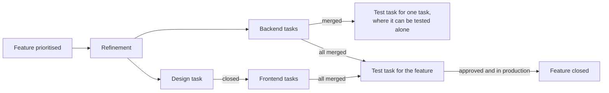

# How we work: the working process for Team Autorisasjon

*Drafted with AI assistance (Claude) on 2026-10-28 from the working groups' pages and revised through review in [PR #4577](https://github.com/Altinn/altinn-auth/pull/4577). Human reader of the final wording: not confirmed. The document describes the process only; who holds which role is set in the board set-up issue, [#4088](https://github.com/Altinn/altinn-auth/issues/4088). Items marked "decided later" wait for a working group.*

## 1. Working method

We work in two-week sprints, shared by both teams, on one board. Work is organised as features under epics, and every feature is split into one task per role.

One rule drives the flow: **every role has its own issue on the board. You get it when the previous issue closes, and you close it when your part is done.** Most moves on the board therefore happen by themselves, and the board is always the truth about where the work stands.

The process has no name of its own and follows no named method. Its parts are called what they do: a sprint, a planning, a result meeting, a test task. Where a practice from Scrum or Kanban fits, we use it; where it does not, we leave it out.

## 2. The sprint

Two weeks. Planning opens the sprint; the result meeting and the retro close it.

|        | Monday | Tuesday | Wednesday | Thursday | Friday |
| ------ | --- | --- | --- | --- | --- |
| Week 1 | **Planning** | Prod deploy | Status per area · TT02 deploy | | Status per area |
| Week 2 | Status per area | Prod deploy | Status per area · TT02 deploy | **Prioritisation** | **Result meeting**, then **retro** |

| Meeting | When | Length | Who | Purpose | Result |
| --- | --- | --- | --- | --- | --- |
| Prioritisation | Thursday, week 2 | 45 min | Product owners, tech leads, design lead. Agile coach facilitates. An area owner with something urgent | Confirm the list for the next sprint from what is refined. Pick candidates for the sprint after | A prioritised top list on the board |
| Planning, joint part | Monday, week 1 | 60 min the first two sprints, then 30 | Everyone. Agile coach facilitates | Two or three sprint goals | Sprint goals written in the iteration |
| Planning, per area | Same meeting | | Area owner, deputy, those working in the area. Product owner as needed | Who does what | The issues in the sprint's iteration |
| Status | Wednesday 60 min. Friday of week 1 and Monday of week 2, 30 min | 30–60 min | Per area or focus group, never the whole team | Blockers and need for help | Blockers flagged on the issue |
| Refinement | As needed, per area or two to three areas together | | Area owner, resource person, the person who will do the work, designer, tester. Tech lead and product owner as needed | Refine the candidates for the next sprint | Issues that meet the Definition of Ready |
| Result meeting | Friday, week 2 | 45 min | Everyone. Stakeholders who waited for a delivery | Show what was delivered. Status for what was not finished | Every unfinished issue gets a decision: continue, split or drop |
| Retro | Friday, week 2, right after | 45 min | Everyone. Agile coach facilitates | What we change in how we work | A prioritised list of adjustments, each with an owner. Notes go on the retro board before the meeting |

These meetings replace each team's current grooming, team meeting and Friday meeting.

## 3. Roles and responsibilities

Each role owns one kind of decision and has the last word on it.

| Role | Owns | Does not |
| --- | --- | --- |
| Product owner | What and why: priority, epics, expectations towards service owners and management | Decide how something is solved technically |
| Agile coach | The working process: facilitates planning, result meeting and retro, writes down decisions | Prioritise issues |
| Tech lead | Technical direction and architecture across areas. Takes part in prioritisation | Own single areas |
| Design lead | Coherence in design and user experience. Approves design review | Design every issue in detail |
| Area owner, with a deputy | The whole of their area across backend, frontend, design and test. Leads refinement, makes sure every feature has a tester. First contact when something is urgent | Necessarily do all the work in the area |
| Resource person | The domain knowledge in an area. Takes part in refinement and pairs with the person doing the work | Act as first contact |
| Designer | User testing and design before and during build. Closes the design task when it is good enough to build | Hold the design task open until the design is final |
| Developer | Their own tasks from Ready to merged pull request. Automated tests for their own code | Move to Done; the merge does that |
| Tester | Verification of tasks and features against the acceptance criteria. The Playwright suite | Run manual regression every week |
| Vakt | Requests in Slack and cases from the CRM, as `kind/question` and `kind/incident` issues on the board, outside the sprint. Creates a task or bug when something needs code or a release | Pull vakt cases into the sprint |

## 4. Agreements

### 4.1 Definition of Ready

A feature can move to Ready when all of these hold:

- It has a priority and a milestone, and belongs to an epic where one exists. A bug or a small task may stand alone.
- It is refined: split into design, backend, frontend and test tasks, with acceptance criteria that someone other than the author can test against.
- The design is in the feature where users will see the change, or the design task is created.
- It can show progress within one sprint: at least one of its tasks is expected to close in the sprint it starts.

**Work that cannot be split.** What cannot be shipped in pieces can still be done in steps. A migration goes live once, but "new schema", "migrate data", "switch reads", "remove old path" are four tasks that close one after another, and each close is visible progress. So a large feature is split by steps of work, not by what can ship, and it is allowed to span several sprints as long as one task closes per sprint. Where even that is impossible, the task stays in In progress across sprints, the developer writes one line of status on it before each result meeting, and the result meeting gives it the usual decision: continue, split or drop. Nothing is cut smaller than it is just to fit a sprint.

### 4.2 Definition of Done

Done means two things, at two levels:

- **A task is done when it is merged.** Automated tests are green. The pull request closes the task.
- **A feature is done when** all its tasks are merged, design review is approved for changes users will see, the test task is closed with an approved result, and the change is in production.

### 4.3 Decisions

- **Last word.** Product owner on priority, tech lead on technology, design lead on design, area owner on their area.
- **Timebox.** A discussion in planning, status or result meetings gets a few minutes. Not agreed? It leaves the meeting: the owner books a short meeting with the people it needs, and the outcome is written on the issue.
- **Read back.** In the last three minutes of every meeting, the facilitator reads out what was decided, who does what, and by when.
- **Write down.** Sprint goals in the iteration and in Slack. A decision about an issue as a comment on the issue. A decision for the whole team in the decision log.
- **The decision log** is `docs/decisions.md` in this repository: one table with date, decision, who decided, and a link. The agile coach adds the rows after each meeting, batched in one pull request per sprint. A row that turns out to be a lasting trade-off becomes an ADR, and the row links to it.
- **Sensitive decisions.** The repository is public, so the log records that a decision was made and where the details live, never the details. Vulnerabilities stay in the private security advisory, incidents with customer data in the incident channel or the CRM case. Before logging anything with `kind/security` or `kind/incident`, the agile coach checks the wording with a tech lead. Nothing goes in a row that could not go in a public issue, and the [data policy](../ai/data-policy.md) applies.

## 5. How work comes in

1. **Idea.** Anyone creates an issue with the repository's form. It lands in Backlog with `status/triage`. Triage means: it is a real issue, not a duplicate, and it has a type and an `area/*` label. That is done within the week, by whoever is closest to it:
   - **The area owner** triages what lands in their area, at the latest in the area's next refinement.
   - **The developer who found it** triages it themselves: a bug they hit, a follow-up from a review, a small fix in their own area. They set type and area, link it to the feature or epic it belongs to, and if it needs a priority or a milestone they mention the area owner. A small fix in their own area, under half a day and with no change users or vendors would notice, can go straight to In progress with the current milestone and priority `normal`.
   - **The vakt** triages what comes in from Slack or the CRM and has no obvious area, and creates the issue when a case needs code or a release.
   - **Nobody claimed it** after a week: the area owner for the closest area takes it in refinement.

   `status/triage` is removed when the issue has a type and an area. Priority and milestone are set by the product owner at prioritisation or refinement; an issue can sit in Backlog without them. An issue nobody has touched for ninety days gets a comment from the `lukkekandidater` report and is closed at the next refinement unless someone claims it. The product owners adjust this when they report; until then, this is what we do.

**Vakt cases** are on the board but not in the sprint. A question from Slack or a case from the CRM that needs more than an answer in the thread becomes an issue with `kind/question`; an outage becomes an issue with `kind/incident`. Both get an `area/*` label and go on the board, so there is one place to look, but they get no iteration, so they never appear on the sprint board. The vakt works them in a vakt view and closes them when answered or resolved. If a case needs a code change or a release, the vakt creates a normal task or bug under the feature or epic it belongs to, links it from the case, and it enters intake like any other issue. An incident goes straight to In progress in the current iteration, bypassing Ready and the column limit, and is mentioned in the result meeting even if it is closed, so the sprint's record shows what displaced planned work. The rotation is one person per week; whether that is enough capacity is a question for the retro, not for this document.
2. **Prioritisation.** On Thursday of week 2, product owners, tech leads and design lead pick the candidates for the sprint after next, and confirm the list for the next sprint from what is already refined.
3. **Refinement, the sprint before.** A feature is refined in the sprint before it is built. Area owner, resource person, the person who will do the work, designer and tester split the feature into tasks and write acceptance criteria. What can start now moves to Ready.
4. **Planning** takes only features that are refined. A feature that missed refinement waits one sprint.

| | Sprint N−1 | Sprint N |
| --- | --- | --- |
| Prioritisation (Thursday, week 2) | Confirms the list for N. Picks candidates for N+1 | Confirms N+1. Picks N+2 |
| Refinement | The candidates for N are refined | The candidates for N+1 are refined |
| Design | The design task for N starts | The design task for N+1 starts |
| Build and test | | The feature for N is built and tested |

## 6. How work flows

| Step | Issue | Appears in Ready when | Closes when |
| --- | --- | --- | --- |
| Refinement | The feature | The feature is prioritised | The tasks are created and the acceptance criteria written |
| Design | Design task under the feature | Refinement is done | The design is good enough to start building, and tech has said it can be built |
| Build, backend | Backend task | Refinement is done | The pull request is merged |
| Build, frontend | Frontend task | The design task it waits for is closed | The pull request is merged |
| Test of one task | Test task under the developer task, where it can be tested alone | Preparation: as soon as refinement is done. Execution: the developer task is closed | The tester has written the result and approved |
| Test of the feature | Test task under the feature | Preparation: as soon as refinement is done. Execution: all developer tasks are closed | The tester has written the result and approved |
| Done | The feature | | The test task is closed and the change is in production |

**Why it runs by itself.** The chain is driven by two things GitHub has: sub-issues and closing. One rule: *an issue appears in Ready when what it waits for is closed.*

- The feature's test task is a sub-issue of the feature and waits for all the other sub-issues.
- A task that can be tested alone gets its own test task as a sub-issue of itself, created in refinement.
- A frontend task that needs the design is marked "blocked by" the design task.

In the first iteration of the process, the person who closes an issue makes the handoff: the designer who closes a design task moves the frontend tasks that waited for it to Ready, the developer whose last task under a feature merges mentions the tester in the feature's test task, and the tester sets the Test phase. Everything in the sprint shows in each role's view by itself; only the handoff signal is by hand. A small GitHub Action that makes those handoffs automatic is planned for a later iteration, once the first sprints have shown the chain works (10).

**Every handoff for one feature, and what is automatic.**

| From | To | Trigger | Who makes the handoff now | Later, by the Action |
| --- | --- | --- | --- | --- |
| Product owner | Area owner | Feature picked as candidate in prioritisation | The product owner sets priority and milestone; the area owner sees it in the Features view | A comment to the area owner when a feature gets a milestone |
| Area owner | Designer, developers, tester | Refinement done | The area owner moves the tasks that can start to Ready | Stays manual; Ready is a judgement |
| Designer | Frontend developer | Design task closed | The designer moves the frontend tasks that waited for it to Ready | The move |
| Backend developer | Frontend developer | Backend task closed, where frontend waits for an API | The developer moves the waiting task to Ready | The move |
| Developer | Tester, one task | Developer task closed by merge | The developer mentions the tester in the task's own test task; the tester moves the card to Executing | The phase and the comment |
| Developers | Tester, the feature | Last developer task under the feature closed | The developer whose task was last mentions the tester in the feature's test task; the tester moves the card to Executing | The phase and the comment |
| Tester | Design lead | Feature's test task moves to Executing and the feature has a design task | The tester adds the design lead as second assignee | The assignment |
| Tester | Developer | Bug found in test | The tester creates the bug as a sub-issue of the feature; it shows in the developer view by itself | Nothing more needed |
| Developer | Tester | Bug closed by merge | The developer mentions the tester in the test task; the tester sets Retest | The phase and the comment |
| Tester | Product owner | Feature closed after production check | The epic's sub-issue count moves by itself; the product owner closes the epic | Nothing more needed |
| Release | Tester | Change deployed to production | Decided by the release group | The deploy workflow labelling the issue |

Two things make the handoffs findable: a task is a sub-issue of its feature where it has one, and test tasks carry `kind/testplan`. Both are set in refinement. "Blocked by" on a task that waits for another is good to set too, since it is what the later Action will read.

**Tasks under one feature can be in different sprints.** The design task for a feature built in sprint N is created in refinement during sprint N−1 and gets iteration N−1; the developer and test tasks get iteration N. The designer sees the design task on this sprint's board and works it now, the developers see theirs next sprint, and the feature is the same issue. Nothing in the chain cares which sprint a task is in; only closing matters.

**Test preparation runs alongside development.** The test task has two phases. Preparation, test data, tools, test cases, environment, starts as soon as refinement is done: the tester pulls the test task into In progress at the same time as the developers pull theirs, sets the Test phase field to Preparing, and works through the checklist in the task. Execution starts when the last developer task closes: the developer mentions the tester in the test task, the tester moves the card to Executing, and the preparation is already done. A test task in In progress therefore does not mean testing has started; the Test phase field says which phase it is in, and it is the column in the test board.

**How a feature's progress counts.** A feature's sub-issue progress counts every direct sub-issue, design task, developer tasks and test task alike. A feature with one design task, three developer tasks and one test task shows 0 of 5 at the start and 4 of 5 when only the test task is open. That last state is what the developer's mention marks, and what the later Action will look for: every sub-issue without `kind/testplan` is closed. A test task for a single developer task is a sub-issue of that task, so it counts in the task's progress, not the feature's. An epic's progress counts its features the same way.

**When design and frontend overlap.** This is normal, not an exception. The design task closes when the design is good enough to start building. Later iterations become new, small design tasks under the feature; the frontend task is blocked by one of them only when it genuinely cannot continue without it. Otherwise the change goes as a comment on the frontend task. Design review before testing catches drift: if the built result does not match the latest design, that is a bug under the feature.

**When verification fails.** The failure becomes a bug linked to the feature. The test task stays open until the bug is fixed and retested. If the failure blocks a release, the tester says so and the team decides.

**Design review.** For a feature users will see, design review is part of the feature's test task, not a step of its own. When the test task moves to Executing, the tester adds the design lead as a second assignee. The design lead checks the built result in AT against the latest design and writes "Design review: approved" in the test task, or files bugs under the feature for what deviates. The tester's functional test runs in parallel; the test task closes only when both are approved. A deviation the team accepts for now, usually for lack of time, is written as a design task in Backlog with `kind/design`, linked to the feature. That is the design debt, and the design lead's view shows it. The design lead's overview of what ships when is the epics-and-features view filtered on the current iteration and milestone.

**Blocked work** keeps its column and gets `status/blocked` with a link to what blocks it, and is raised in the status meeting. If urgent: directly with the person blocking, then the area owner.

## 7. How work ends

| What | Closed by | When |
| --- | --- | --- |
| Developer task | The merge | The pull request merges |
| Design task | The designer | The design is good enough to build |
| Test task | The tester | The result is written and approved |
| Feature | The tester | Checked in production after Tuesday's deploy. **Decided later:** whether the deploy workflow can do this |
| Epic | The product owner, in the result meeting | The last feature is closed, which says the roadmap goal is met |

**The result meeting** shows what was delivered and gives every unfinished issue a decision. **The retro** right after decides what we change. Done cards are archived after the result meeting.

## 8. Rituals per role

Every role reads the same way: the view you look at, how you know it is your turn, what each status means for your issues, what you do, what you close.

**Product owner**
- View: epics and features, `type:Epic,Feature`, table layout, sorted by milestone, with sub-issue progress and iteration as columns.
- Your turn: the prioritisation meeting on Thursday of week 2; when a feature in the Features view has no milestone; when a feature closes and an epic's sub-issue count reaches complete.
- Status on a feature: Backlog is not yet refined, Ready is refined and waiting for a sprint, In progress is being built, Done is in production.
- You do: set priority and milestone, confirm the next sprint's list, pick candidates for the sprint after, decide what leaves the sprint when something urgent comes in.
- You close: the epic, in the result meeting, when its last feature is closed.

**Area owner**
- View: everything in your area, `label:area/<name>`, grouped by parent issue, so each feature shows with its tasks under it.
- Your turn: when a feature in your area gets a milestone, which you see in the Features view; when a task in your area is blocked and raised in the status meeting; when something urgent lands in your area.
- Status on a feature: Backlog means refine it in the sprint before it is built; Ready means refined, tasks exist, waiting for planning; In progress means at least one task is open; Done is in production.
- You do: run refinement with designer, developer, tester and resource person; split the feature into tasks as sub-issues; create the test tasks; mark frontend tasks that wait for design or an API as "blocked by"; move what can start to Ready. Make sure every feature has a tester.
- You close: nothing in the chain. The feature closes by the tester; you keep its tasks correct.

**Designer**
- View: design tasks, `label:kind/design`, table layout, sorted by iteration then status, with parent issue and milestone as columns.
- Your turn: prioritisation, where the design lead sees which features are coming one sprint ahead; refinement, where the design task is created and assigned to you; the design view, where a task in Ready in the current iteration is work to start now. Being assigned is itself a notification. A design task assigned to you for a feature whose refinement you were not in starts with a conversation with the area owner, not with designing.
- Status on a design task: Backlog is created but the feature is not in a sprint; Ready is agreed in refinement, start now; In progress is designing or testing with users; Done is closed at "good enough to build".
- You do: test with users and design in parallel with backend, check with tech that it can be built, put the design in the feature. Later iterations become new, small design tasks under the feature.
- You close: the design task, when the design is good enough to start building. Then you move the frontend tasks that waited for it to Ready.
- The design lead also sees the feature's test task when it enters execution, as second assignee, and writes "Design review: approved" or files bugs.

**Developer**
- View: developer tasks, `type:Task,Bug -label:kind/testplan -label:kind/design`, board layout filtered on the current iteration, sorted by priority, so the top card in Ready is the one to take.
- Your turn: when a task in Ready has you as assignee or is unassigned at the top; when a task you wait for closes and the person who closed it moves yours to Ready; when a bug under your feature appears in the view.
- Status on a task: Ready is take it; In progress is yours; In review is pull request open, take the next one; Done is merged.
- You do: move to In progress, build, cover with automated tests, open a pull request with `Resolves: #task`, move to In review, take the next. Handle review comments in the same task; new findings become new tasks or bugs. If blocked, write it on the task, add `status/blocked`, raise it in the status meeting. A bug you find yourself: create it, set type and area, link it to its feature, and take it if it is small.
- You close: nothing by hand. The merge closes the task, and the board moves it to Done. Then one mention: if the task has its own test task, mention the tester there; if yours was the last open task under the feature, mention the tester in the feature's test task. If another task waited for yours, move it to Ready.

**Tester**
- View: test tasks, `label:kind/testplan is:open`, as a board whose columns are the Test phase field, not Status: no phase, Preparing, Executing, Retest. You move the card to Executing when the developer mentions you that the last task is merged. How close a feature is to that comes from the Features view, which shows each feature's sub-issue count.
- Your turn: refinement, where you say what can be tested alone and the test tasks are created; the first day of the sprint, when you pull the test task into In progress to prepare; the developer's mention in the test task when the last developer task is merged, which starts execution.
- Status on a test task: Backlog is created, feature not in a sprint; Ready is in the sprint, nothing done; In progress is preparing or executing; Done is result written and approved. The Test phase field says which: Preparing, Executing, Retest. You set it, by moving the card on the test board.
- You do: prepare test data, tools, test cases and environment while the developers build. Execute in AT against the acceptance criteria when the comment arrives. Write what was tested and the result in the test task. A failure becomes a bug as a sub-issue of the feature; the test task stays open until it is fixed and retested. If a failure blocks a release, say so and the team decides. Check the feature in production after Tuesday's deploy.
- You close: the test task, once you have approved and, where the change is user-facing, the design lead has too. Then the feature, after the production check.

**Tech lead**
- View: the epics and features view, and the per-area views for cross-area work.
- Your turn: prioritisation; refinement of features that cross areas; a technical question taken out of a meeting; the decision log check before a `kind/security` or `kind/incident` decision is logged.
- You do: decide technical direction across areas, take part in prioritisation, settle parked technical questions.
- You close: nothing in the chain.

**Agile coach**
- View: the sprint board, and the result-meeting view of this sprint's features.
- Your turn: planning, result meeting and retro; the last three minutes of every meeting; after each meeting, the decision log.
- You do: facilitate, keep the timebox, read the decisions back, write the sprint goals in the iteration and in Slack, add the decision log rows.
- You close: nothing in the chain.

**Vakt**
- View: the vakt view, `label:kind/question,kind/incident is:open`.
- Your turn: the whole week you hold the rotation, for anything from Slack or the CRM that needs more than a reply in the thread.
- Status on a vakt case: Backlog is received, In progress is being handled, Done is answered or resolved. Vakt cases have no iteration.
- You do: create the issue with `kind/question` or `kind/incident` and an area label, handle it, and if it needs code or a release, create a task or bug under the right feature or epic and link it from the case. An incident goes straight to In progress in the current iteration.
- You close: the vakt case, when it is answered or resolved. Mention incidents in the result meeting even if closed.

## 9. The board

- **One board** for both teams. No boards per role; views instead. Bugs are a view.
- **Five columns.** Backlog: known, not planned. Ready: the top issue is the right one to take. In progress: few active issues per person, no hard limit. In review: pull request open. Done: closed.
- **Hierarchy.** Epic, feature, task. Test tasks carry `kind/testplan` and design tasks `kind/design`. A task is a sub-issue of its feature where it has one; a bug or a small task may stand alone. `kind/design` is a new value in ADR-0004's `kind/*` group; this document records that amendment, and ADR-0004 is otherwise unchanged. The board set-up issue brings the repository's labels in line with ADR-0004 at the same time.
- **Fields.** One question per mechanism:

  | Mechanism | Answers | How we use it |
  | --- | --- | --- |
  | Iteration | Which sprint | The two-week sprint. The sprint board filters on it. Set at planning. |
  | Milestone | Which dated target | A roadmap target with a due date, such as a removal deadline or a committed scope. Few, cross-area, named by the target as ADR-0004 says. A feature gets the milestone it must be in by; an epic needs none, its features carry it. Set by the product owner. |
  | Priority | In which order | Order within the current and next sprint. `urgent` requires a date in the issue; without one it is `high`. Set by the product owner in prioritisation. |
  | Labels | What kind, where | Type, `area/*`, `kind/*`. Classification, never scheduling. |
  | Epic | Which goal | Groups the features that serve one roadmap item. No date of its own. |
  | Test phase | Where a test task is | Preparing, Executing, Retest. Only on test tasks. The tester sets it by moving the card on the test board. The columns of the test board, since a checklist in the issue body cannot be one. |

  There is no horizon field on the board. "Now" is the current iteration, "next" is a milestone without an iteration, "later" is no milestone, and the board already shows all three. If the product owners want a Now, Next, Later roadmap view for stakeholders, it is a field on epics only, set by them and shown in its own view, never on features or tasks.
- **Views.** Seven, each a saved filter and a column field on the same board. Anything more is added only when someone asks for it:

  | View | Filter | Columns | For |
  | --- | --- | --- | --- |
  | Sprint, the default | `iteration:@current` | Status | Everyone |
  | Developers | `type:Task,Bug -label:kind/testplan -label:kind/design iteration:@current` | Status | Developers |
  | Test board | `label:kind/testplan is:open` | Test phase | Testers |
  | Design | `label:kind/design is:open` | Status | Designers |
  | Features | `type:Epic,Feature is:open`, table | Sub-issues progress, Milestone, Status | Product owner, area owners |
  | Area, one per area | `label:area/<name> is:open`, grouped by parent issue | Status | Area owners |
  | Vakt | `label:kind/question,kind/incident is:open` | Status | The vakt |

  Projects can filter by label but not group by it, so "per area" is one saved view per area, made by the area owner. Bugs show on the Developers board. We start with this and see after the first sprints what is missed.

  The role views show sub-issues, since that is what people work on, and they start at Ready: Backlog is not a column in them. Backlog is seen in the Features view, which is where it is worked.

- **Automation.** Built in: a new issue from the repository is added to the board, a closed issue moves to Done, a reopened issue moves to In progress, Done cards are archived after the result meeting.

  Nothing else is automated in the first iteration. The handoffs between roles are a move or a mention by the person who finished, as section 6 lists. A GitHub Action that makes those handoffs automatic, when an issue closes, move what waited for it to Ready and set the test phase, is specified in the board set-up issue, [#4088](https://github.com/Altinn/altinn-auth/issues/4088), and comes in a later iteration (10).

## 10. Decided later

- **Release.** How a change reaches TT02 and production, who does it, the hotfix path, and whether the deploy workflow can label issues with `prod` and close features. Until then: merge deploys to AT, TT02 on Wednesdays, production on Tuesdays, regression runs automatically in TT02 before release.
- **The handoff Action.** After the first sprints have shown the chain works by hand: an Action that, when an issue closes, moves what waited for it to Ready, moves the test task to Executing, and adds the design lead. Specified in the board set-up issue. Not before the labels and forms are in place, since it matches on them.
