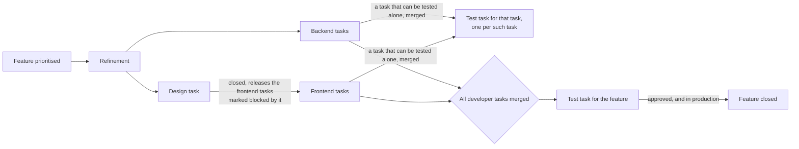
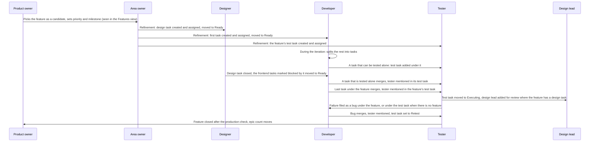

# How we work

*The handbook for the working process decided in [ADR-0005](../adr/0005-planning-and-flow.md). Drafted with AI assistance (Claude) on 2026-10-27 from the working groups' pages and revised through review in [PR #4577](https://github.com/Altinn/altinn-auth/pull/4577). Human reader of the final wording: @acn-dgopa. The ADR holds the decisions; this page describes how they are run. A change to how we run it is a change here; a change to a decision is a new ADR.*

**TL;DR**

- Two-week iterations: planning on the first Monday, status per area, prioritisation on the second Thursday, result meeting and retro on the second Friday.
- A feature is refined in the iteration before it is built, with designer, developer and tester in the room, to "enough to start": goal, main acceptance criteria, named people, a first task. The developer splits the rest during the iteration.
- Every role has its own issue and its own board view. You get your issue when the previous one closes, and the person who finished moves it or mentions you.
- A task is done when merged; a feature when its test task is approved and the change is in production.
- Backlog is everything not in an iteration. Role views start at Ready.

## 1. The iteration

Two weeks. Planning opens the iteration; the result meeting and the retro close it.

|        | Monday | Tuesday | Wednesday | Thursday | Friday |
| ------ | --- | --- | --- | --- | --- |
| Week 1 | **Planning** | Prod deploy | Status per area · TT02 deploy | | Status per area |
| Week 2 | Status per area | Prod deploy | Status per area · TT02 deploy | **Prioritisation** | **Result meeting**, then **retro** |

| Meeting | When | Length | Who | Purpose | Result |
| --- | --- | --- | --- | --- | --- |
| Prioritisation | Thursday, week 2 | 45 min | Product owners, tech leads, design lead. Agile coach facilitates. An area owner with something urgent | Confirm the list for the next iteration from what is refined. Pick candidates for the iteration after | The candidates for refinement, with priority and milestone set |
| Planning, joint part | Monday, week 1 | 60 min the first two iterations, then 30 | Everyone. Agile coach facilitates | Two or three iteration goals; priority adjusted on the Ready features if needed | Iteration goals written in the iteration; the iteration ordered by priority |
| Planning, per area | Same meeting | | Area owner, deputy, those working in the area. Product owner as needed | Who does what | The issues in the iteration |
| Status | Wednesday 60 min. Friday of week 1 and Monday of week 2, 30 min | 30–60 min | Per area or focus group, never the whole team | Blockers and need for help | Blockers flagged on the issue |
| Refinement | As needed, per area or two to three areas together; short | | Area owner, resource person, the person who will do the work, designer, tester. Tech lead and product owner as needed | Give the candidates for the next iteration enough to start | Features that meet the Definition of Ready |
| Result meeting | Friday, week 2 | 45 min | Everyone. Stakeholders who waited for a delivery | Show what was delivered. Status for what was not finished | Every unfinished issue gets a decision: continue, split or drop |
| Retro | Friday, week 2, right after | 45 min | Everyone. Agile coach facilitates | What we change in how we work | A prioritised list of adjustments, each with an owner. Notes go on the retro board before the meeting |

These meetings replace each team's current grooming, team meeting and Friday meeting.

## 2. Roles and responsibilities

Each role owns one kind of decision and has the last word on it.

| Role | Owns | Does not |
| --- | --- | --- |
| Product owner | What and why: priority, epics, expectations towards service owners and management | Decide how something is solved technically |
| Agile coach | The working process: facilitates planning, result meeting and retro, writes down decisions, archives Done after the result meeting | Prioritise issues |
| Tech lead | Technical direction and architecture across areas. Takes part in prioritisation | Own single areas |
| Design lead | Coherence in design and user experience. Approves design review | Design every issue in detail |
| Area owner, with a deputy | The whole of their area across backend, frontend, design and test. Leads refinement, makes sure every feature has a tester. First contact when something is urgent | Necessarily do all the work in the area |
| Resource person | The domain knowledge in an area. Takes part in refinement and pairs with the person doing the work | Act as first contact |
| Designer | User testing and design before and during build. Closes the design task when it is good enough to build | Hold the design task open until the design is final |
| Developer | Their own tasks from Ready to merged pull request. Automated tests for their own code | Move to Done; the merge does that |
| Tester | Verification of tasks and features against the acceptance criteria. The Playwright suite | Run manual regression every week |
| Vakt | Requests in Slack and cases from the CRM, as `kind/question` and `kind/incident` issues on the board. Creates a task or bug when something needs code or a release | Pull question cases into the iteration |

## 3. The flow in short

One rule: **every role has its own issue on the board. You get it when the previous issue closes, and you close it when your part is done.** A feature is split into design, backend, frontend and test tasks, as sub-issues of the feature: the first in refinement, the rest by the developer during the iteration. Closing an issue makes the issues that waited for it eligible for their next step; the person who finished makes the handoff, a move or a mention.

| Step | Issue | Starts when | Closes when |
| --- | --- | --- | --- |
| Refinement | The feature | Prioritised; stays in Backlog until it is enough to start | Its test task is approved and the change is in production |
| Design | Design task under the feature | Refinement is done | The design is good enough to start building, and tech has said it can be built |
| Build, backend | Backend task | Refinement is done | The pull request is merged |
| Build, frontend | Frontend task | Refinement is done, or, if it is marked "blocked by" the design task, when that closes | The pull request is merged |
| Test of one task | Test task under a developer task that can be tested alone | Preparation when refinement is done; execution when that task is merged | The tester has written the result and approved |
| Test of the feature | Test task under the feature | Preparation when refinement is done; execution when all developer tasks are merged | The tester has written the result and approved |

The handoffs, in order, and who makes each:

Three things make the handoffs findable: every task is a sub-issue of its feature where it has one, test tasks carry `kind/testplan`, and a task that waits for another is marked "blocked by" it, which is mandatory when the blocker is known. Test tasks are normally created in refinement, but one can be added at any point, including by a developer when development shows a change needs manual testing. A GitHub Action that makes the moves and mentions automatic is a later iteration, see section 6.

## 4. How work comes in

1. **Idea.** Anyone creates an issue with the repository's form. It lands in Backlog with `status/triage`. Triage means: it is a real issue, not a duplicate, and it has a type and an `area/*` label. That is done within the week, by whoever is closest to it: the area owner for their area, at the latest in the next refinement; the developer who found it, for a bug they hit, a follow-up from a review or a small fix in their own area, who sets type and area, links it to its feature or epic, and mentions the area owner if it needs a priority or a milestone; the vakt, for what comes from Slack or the CRM; and the nearest area owner after a week if nobody claimed it. `status/triage` is removed when the issue has a type and an area. An issue nobody has touched for ninety days gets a comment from the `lukkekandidater` report and is closed at the next refinement unless someone claims it. The product owners adjust this when they report.
2. **Small fixes** in a developer's own area, under half a day and with no change users or vendors would notice, go straight to In progress with the current iteration, the current milestone and priority `normal`. If the change needs manual testing, the developer creates a test task under it, like any other.
3. **Vakt cases** are on the board. A question from Slack or a CRM case that needs more than a reply becomes a `kind/question` issue; an outage a `kind/incident` issue; both get an area label. Questions get no iteration and never show on the iteration board; the vakt works them in the Vakt view. Incidents are the exception: straight to In progress in the current iteration, bypassing Ready, and mentioned in the result meeting even if closed. A case that needs code or a release gets a task or bug under its feature or epic, linked from the case, and enters intake like any other issue.
4. **Prioritisation.** On Thursday of week 2, product owners, tech leads and design lead pick the candidates for the iteration after next, and confirm the list for the next iteration from what is refined. A prioritised feature stays in Backlog until it is refined.
5. **Refinement, the iteration before.** Short, and it produces enough to start, not a full breakdown. Area owner, resource person, the developer who will do the work, designer and tester agree the goal and the main acceptance criteria, name the tester, and the developer where one is known, and create the first task as a sub-issue, plus the design task where users will see the change and the feature's test task, assigned to the tester. Tasks that wait for another are marked "blocked by" it. The feature moves to Ready; the area owner moves the tasks that can start to Ready. The design task gets the current iteration, so design runs an iteration ahead; the other tasks get their iteration at planning. During the iteration the developer splits the rest into tasks, pulling in whoever they need, and the tester adds a test task under any task that can be tested alone; everything created during the iteration gets the current iteration, so it shows on the boards.
6. **Planning** takes only features that are enough to start. A feature that is not, by planning, waits one iteration.

| | Iteration N−1 | Iteration N |
| --- | --- | --- |
| Prioritisation (Thursday, week 2) | Confirms the list for N. Picks candidates for N+1 | Confirms N+1. Picks N+2 |
| Refinement | The candidates for N are refined | The candidates for N+1 are refined |
| Design | The design task for N starts, in iteration N−1 | The design task for N+1 starts |
| Build and test | | The feature for N is built and tested |

## 5. Each role in detail

Each role: the view, how you know it is your turn, what each status means for your issues, what you do, what you close. The views are drawn in [Board views](board-views.md).

### Product owner

- **View:** Features, `type:Epic,Feature is:open`, table sorted by milestone, with sub-issue progress and iteration as columns. Progress is the sub-issue count, which includes the design and test tasks: "4 of 5" with one open usually means waiting for test. An epic's count is its features.
- **Your turn:** the prioritisation meeting; when a feature in the Features view has no milestone; when a feature closes and an epic's count reaches complete.
- **Status on a feature:** Backlog is not in an iteration, refined or not; Ready is enough to start and waiting for planning; In progress is being built; Done is in production.
- **You do:** pick candidates for refinement and set their priority and milestone, confirm the next iteration's list, adjust priority at planning if needed, decide what leaves the iteration when something urgent comes in. Deadlines from outside live on the milestone and are yours to hold; the team works to the iteration.
- **You close:** the epic, in the result meeting, when its last feature is closed.

### Area owner

- **View:** Area, `label:area/<name>`, board grouped by parent issue, so each feature shows with its tasks under it. Backlog shows here as the unrefined features.
- **Your turn:** when a feature in your area gets a milestone; when a task in your area is blocked and raised in the status meeting; when something urgent lands in your area.
- **Status on a feature:** Backlog means refine it in the iteration before it is built; Ready means enough to start, first task exists, waiting for planning; In progress means at least one task is open; Done is in production.
- **You do:** run refinement as section 4 describes; make sure every feature has a tester. Blocked work keeps its column with `status/blocked` and a "blocked by" link, and is raised in the status meeting; if urgent, directly with the person blocking, then you.
- **You close:** nothing in the chain. You keep the feature's tasks correct.

### Designer

- **View:** Design, `label:kind/design -status:Backlog`, board by Status like the developers' board, with the parent feature on every card. What waits on a design task is in the task's own "blocking" list, or in the Area view.
- **Your turn:** prioritisation, where the design lead sees which features are coming one iteration ahead; refinement, where the design task is created and assigned to you; the Design view, where a task in Ready in the current iteration is work to start now. A design task for a feature whose refinement you were not in starts with a conversation with the area owner, not with designing.
- **Status on a design task:** Backlog is not in an iteration; Ready is agreed in refinement, start now; In progress is designing or testing with users; Done is closed at "good enough to build".
- **You do:** test with users and design in parallel with backend, check with tech that it can be built, put the design in the feature. Design and frontend overlapping is normal: the design task closes at "good enough to build", later iterations become new, small design tasks under the feature, and the frontend task is blocked by one only when it genuinely cannot continue without it; otherwise the change is a comment on the frontend task. A deviation accepted for now is a design task in Backlog, linked to the feature: that is the design debt, visible on the feature and in the Area view.
- **You close:** the design task, when the design is good enough to start building. Then you move the frontend tasks that were marked "blocked by" it to Ready; frontend tasks that did not wait for the design were never held.
- **Design lead:** when a feature's test task moves to Executing and the feature has a design task, the tester adds you as second assignee. You check the built result in AT against the latest design and write "Design review: approved" in the test task, or file bugs under the feature. The functional test runs in parallel, and the test task closes only when both approve. Your overview of what ships when is the Features view filtered on the current iteration and milestone.

### Developer

- **View:** Developers, `type:Task,Bug,Enhancement -label:kind/testplan -label:kind/design iteration:@current`, board by Status sorted by priority, so the top card in Ready is the one to take.
- **Your turn:** when a task in Ready has you as assignee or is unassigned at the top; when a task you wait for closes and the person who closed it moves yours to Ready; when a bug under your feature appears in the view.
- **Status on a task:** Ready is take it; In progress is yours; In review is pull request open, take the next one; Done is merged. Keep In review short: review others' pull requests before taking a new task.
- **You do:** move to In progress, build, write the unit and integration tests before review, open a pull request with `Resolves: #task`, move to In review, take the next. Handle review comments in the same task; new findings become new tasks or bugs. A feature arrives with enough to start, not fully specified. If you pulled its first task, you are its developer: you split the rest into tasks as sub-issues as you go, each with the current iteration so it shows on the boards, write the finer acceptance criteria, and pull in the designer, tester, area owner or product owner when you need them. If a task lacks information, fill the gap yourself where your own knowledge or a quick check covers it; otherwise ask the author on the task. If blocked, write it on the task, add `status/blocked`, raise it in the status meeting. A bug you find: create it, set type and area, link it to its feature, take it if it is small. A standalone task or bug that needs manual testing: create a test task under it, assigned to a tester, when you open the pull request.
- **You close:** nothing by hand. The merge closes the task and the board moves it to Done. Then one mention: if the task has its own test task, mention the tester there; if yours was the last open task under the feature, mention the tester in the feature's test task. If another task waited for yours, move it to Ready.

### Tester

- **View:** Test board, `label:kind/testplan is:open`, board whose columns are the Test phase field: no phase, Preparing, Executing, Retest. How close a feature is to execution is in the Features view.
- **Your turn:** refinement, where the feature's test task is created and assigned to you; during the iteration, as the developer splits the feature, where you add a test task under any task that can be tested alone, with the current iteration; when refinement is done, to prepare; the developer's mention in the test task when the last task is merged, which starts execution.
- **Status on a test task:** Backlog is not in an iteration; Ready is in the iteration, nothing done; In progress is preparing or executing; Done is result written and approved. The Test phase field says which, and you set it by moving the card on the test board. A test task in In progress does not mean testing has started.
- **You do:** two phases. Preparation, test data, tools, test cases, environment, starts when refinement is done: pull the test task into In progress and set Preparing. Execution starts when the developer's mention arrives: move to Executing, test in AT against the acceptance criteria, write what was tested and the result in the test task, and add the design lead where the change is user-facing. A failure becomes a bug as a sub-issue of the feature, or, for a standalone task or bug, as a sub-issue of the test task itself, so the test task shows it and stays open until it is fixed; set Retest when it is fixed. If a failure blocks a release, say so and the team decides. Check the feature in production after the weekly deploy.
- **You close:** the test task, once you have approved and, where the change is user-facing, the design lead has too. Then the feature, after the production check.

### Tech lead

- **View:** Features, and the Area views for cross-area work.
- **Your turn:** prioritisation; refinement of features that cross areas; a technical question taken out of a meeting; the wording check before a `kind/security` or `kind/incident` decision is logged.
- **You do:** decide technical direction across areas, take part in prioritisation, settle parked technical questions.
- **You close:** nothing in the chain.

### Agile coach

- **View:** the Iteration board, and the Features view for the result meeting.
- **Your turn:** planning, result meeting and retro; the last three minutes of every meeting; after each meeting, the decision log; after the result meeting, archiving Done.
- **You do:** facilitate, keep the timebox, read the decisions back, write the iteration goals in the iteration and in Slack, add the rows to [the decision log](../decisions.md), archive Done.
- **You close:** nothing in the chain.

### Vakt

- **View:** Vakt, `label:kind/question,kind/incident is:open`.
- **Your turn:** the whole week you hold the rotation, for anything from Slack or the CRM that needs more than a reply in the thread.
- **Status on a vakt case:** Backlog is received, In progress is being handled, Done is answered or resolved. Questions have no iteration; incidents get the current one.
- **You do:** create the issue with `kind/question` or `kind/incident` and an area label, handle it, and if it needs code or a release, create a task or bug under the right feature or epic and link it from the case.
- **You close:** the vakt case, when it is answered or resolved. Mention incidents in the result meeting even if closed.

## 6. Decided later

- **Release.** How a change reaches TT02 and production, who does it, the hotfix path, and whether the deploy workflow can label issues with `prod` and close features. Until then: merge deploys to AT, TT02 on Wednesdays, production on Tuesdays, regression runs automatically in TT02 before release. The release group decides.
- **The handoff Action.** After the first iterations have shown the chain works by hand: when an issue closes, move what waited for it to Ready, move the test task to Executing, add the design lead, and comment to the area owner when a feature gets a milestone. Outlined in [Board set-up](board-setup.md) and tracked in [#4088](https://github.com/Altinn/altinn-auth/issues/4088). Not before the labels and forms are in place, since it matches on them.
- **Backlog and design details.** The product owners and the design group adjust sections 4 and 5 when they report.
